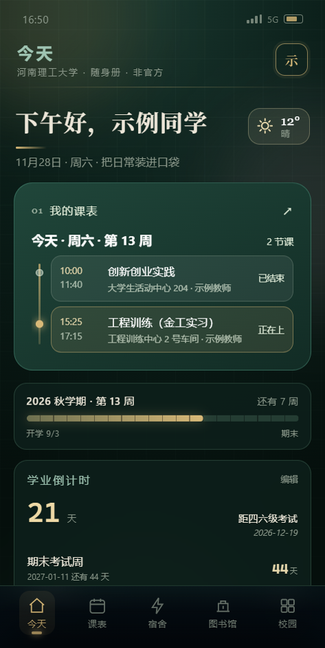
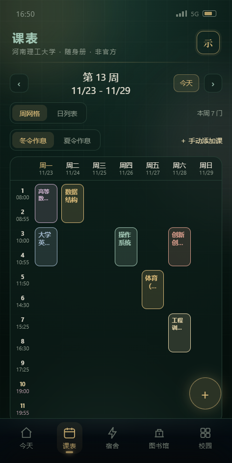
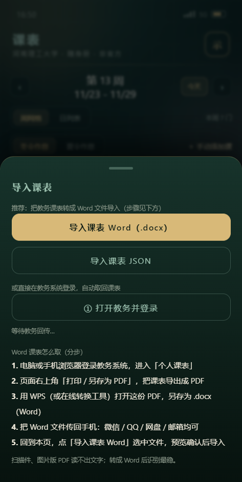
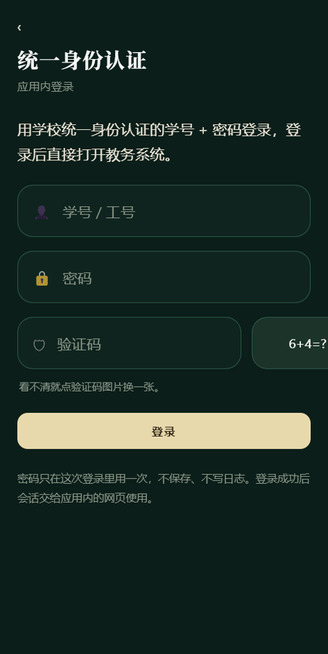
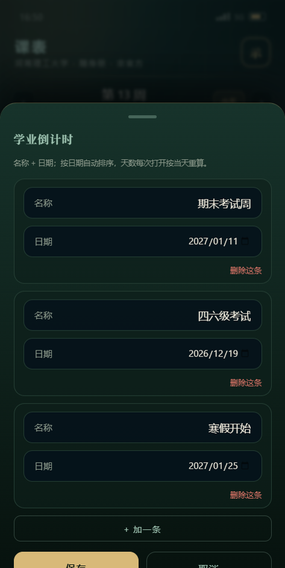
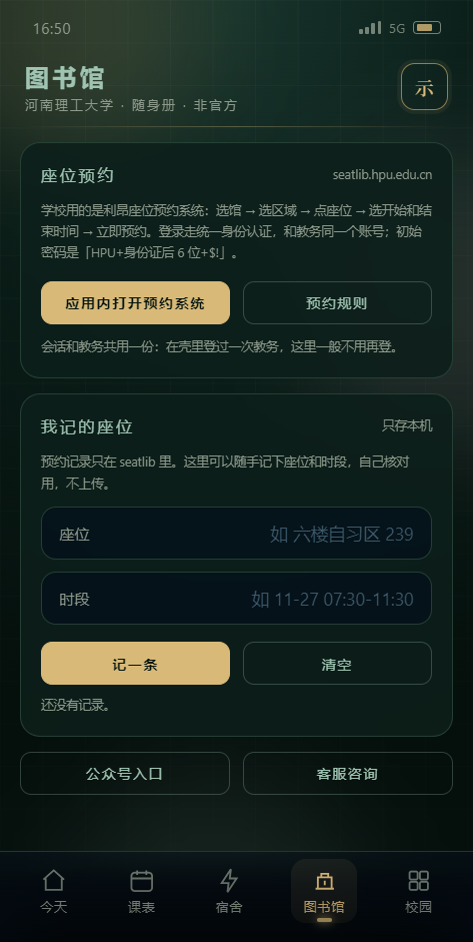
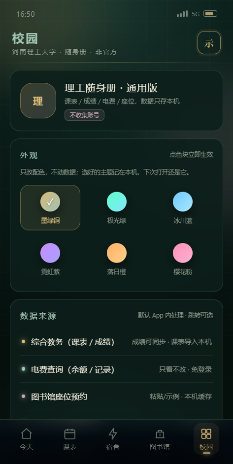
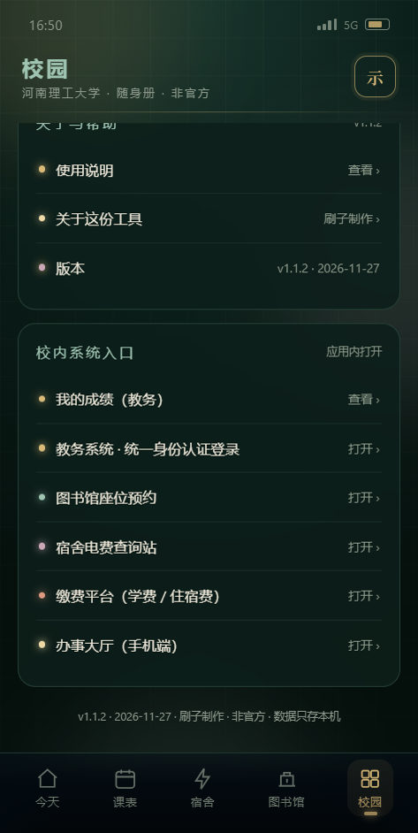
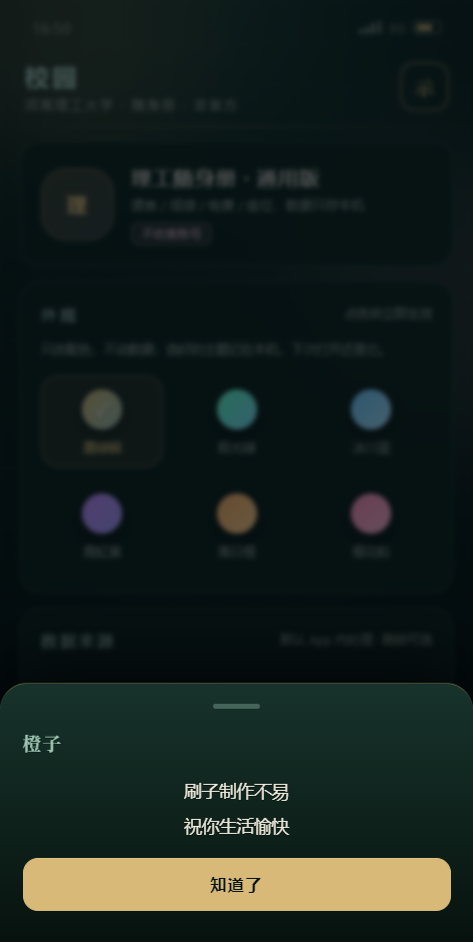

# 理工随身册

河南理工大学校园工具 · 自用 · 不上架 · 数据只存本机

把课表、成绩、宿舍电费、图书馆座位这几件每天都得干的事塞进一个 App，课表一眼能看到，电费余额不用反复登录，成绩同步后自己算加权。

- 平台：Android（minSdk 21，targetSdk 34）
- 当前版本：v1.1.2（2026-11-27）
- 作者：刷子制作
- 仓库：本仓库只做分发和更新，非官方工具，与学校无关

## 界面一览

| 首页 | 课表（周网格） | 导入课表 |
| --- | --- | --- |
|  |  |  |

| 教务登录 | 学业倒计时 | 图书馆座位 |
| --- | --- | --- |
|  |  |  |

| 校园（外观与数据来源） | 校园（版本与校内入口） | 首启署名 |
| --- | --- | --- |
|  |  |  |

截图里的人是「示例同学」，课表和倒计时都是示例数据，不是真人记录。

## 功能清单

| 页面 | 能做什么 | 数据来源 |
| --- | --- | --- |
| 今天 | 今日课表置顶、学期进度（第几周 / 还剩几周）、学业倒计时、成绩速览、电费余额、记事本、快捷入口 | 本机缓存 |
| 课表 | 周网格 / 日列表切换、翻周、冬夏作息切换、手动加课、导入课表、导出课表 | Word / JSON 文件，或教务系统 |
| 宿舍 | 查宿舍电费余额和用量、跳转一卡通购电、应用内直接打开发电站 | 学校电费查询系统（只读） |
| 图书馆 | 打开座位预约系统、记下自己约的座位和时段 | 图书馆座位预约系统（自记项只存本机） |
| 校园 | 六套配色、使用说明、版本与更新、导出 / 导入备份、校内系统入口（教务、缴费、办事大厅等） | 本机设置 + 学校各系统 |

## 安装

1. 打开 [Releases](../../releases) 页，下载最新一版的 `理工随身册-x.y.z.apk`。
2. 手机上允许「安装未知来源应用」后再装。
3. 第一次打开会要求填学号和姓名——只存在这台手机上，用来给教务登录和成绩同步用，密码不保存。

## 使用说明

### 1. 第一次打开

首次启动会弹一个必填的资料面板：学号、姓名，密码可留空。填完点保存，之后每次打开都直接进首页。填完还会弹一次「橙子 / 刷子制作不易 / 祝你生活愉快」，点知道了就行，之后不再弹。

### 2. 导入课表

课表页点「导入课表」，面板里只有三个入口，按推荐顺序排：

1. **导入课表 Word（.docx）**：最稳的一条路，Word 里本来就有表格结构，识别不出错。
2. **导入课表 JSON**：给会自己整理数据的人用，格式见仓库里的 `课表标准格式样例.json` 和 `课表数据契约v1.md`。
3. **打开教务并登录**：应用内打开统一身份认证，登录后自动取回本学期课表（教务偶尔抽风，失败就回到前两条）。

Word 课表怎么取，面板里写了五步，照做即可：

1. 电脑或手机浏览器登录教务系统，进入「个人课表」。
2. 页面右上角「打印 / 另存为 PDF」，把课表导出成 PDF。
3. 用 WPS（或在线转换工具）打开这份 PDF，另存为 `.docx`（Word）。
4. 把 Word 文件传回手机：微信 / QQ / 网盘 / 邮箱都行。
5. 回到本页，点「导入课表 Word」，选中文件，预览确认后导入。

注意：扫描件、图片版 PDF 读不出文字，转成 Word 后识别最稳。

导入前会先给一份预览：门数、按天分布、缺字段提醒、撞课清单。确认后才会写入本机，同一门课重复导入只更新不叠加。

### 3. 课表页

- **周网格**：一屏看完一周，左右箭头翻周，「今天」一键回到本周；课程块颜色按课程区分，当前时间那节课有高亮。
- **日列表**：按一天的时间轴列出，看教室和教师更清楚。
- **冬夏作息**：5.1–9.30 自动按夏令作息，其余按冬令，也可以手动切换，每节课起止时间会跟着变。
- **手动加课**：临时加的课、实验课、选修，直接「+ 手动添加课」，不用改文件。
- **导出**：校园页可以把当前课表导成 JSON，换手机或重装前一键备份。

### 4. 首页（今天）

首页从上到下是：问候语 → 我的课表 → 学期进度 → 学业倒计时 → 成绩 → 电费 → 记事本 → 快捷入口。

- **我的课表**放在最上面：显示今天第几节课、几点到几点、教室和教师，正在上的那节会标出来；今天没课就提示去导入或翻别的周。
- **学业倒计时**：点「编辑」加条目（名称 + 日期），按日期自动排序，最近的一条用大号天数显示，过期的标「已过」。天数每天按当天 0 点重算，不用手动改。
- **学期进度**：按开学日期和总周数算「第几周、还有几周」，进度条直接看。

### 5. 成绩

成绩页从教务同步本学期和往期成绩，按学分算加权平均和 GPA。教务要重新登录时，页面上会提示，跟着走一遍统一身份认证就行。

### 6. 宿舍电费

宿舍页选楼栋 → 楼层 → 房间，点「查询电量」读学校电费站的实时余额和用量，读数只查不改，充值还是走一卡通。选过的房间会记住，首页电费卡直接显示余额。

### 7. 图书馆座位

点「应用内打开预约系统」，选馆 → 选区域 → 点座位 → 选开始和结束时间 → 立即预约。登录走统一身份认证，和教务同一个账号，初始密码是「HPU+身份证后 6 位+!」。

约完可以在下面的「我记的座位」记一条，方便自己核对；这条只存本机，不上传，也不代表系统里的预约状态。

### 8. 校园页

- **外观**：墨绿铜、极光绿、冰川蓝、霓虹紫、落日橙、樱花粉六套配色，点了立刻生效，下次打开还是这套。
- **数据来源**：写清每个模块的数据是从哪来的、哪些只读、哪些只存本机。
- **使用说明 / 关于 / 版本**：版本号、构建日期、作者。
- **校内系统入口**：成绩、教务登录、图书馆、电费、缴费平台、办事大厅，都在应用内打开，不用来回切浏览器。

## 版本校验

App 启动时会读本仓库的最新 tag，和自己内置的版本号比对：

- 一致：正常使用。
- 不一致：全屏提示「当前版本 / GitHub 最新版本 / 请更新」，必须先更新到最新版才能继续用。
- 读不到（没网、接口异常）：直接放行，不影响自己用。

这样分发出去的包始终对齐仓库里的最新版本，不会出现「你用的还是老版本、问题早就修了」的扯皮。

## 数据与隐私

- 学号、姓名只存在本机 `localStorage`，用来填登录表单；密码只在当次登录用一次，不落盘、不写日志。
- 课表、成绩、电费、座位记录都只在本机，没有服务器，也不上传。
- 没有埋点、没有统计、没有广告 SDK。
- 仓库是公开的，代码里不含任何真实学号姓名；截图里的课程、教师、教室都是占位内容。

## 已知限制

- 教务系统偶尔返回报错（例如 `id to load is required for loading`），是教务侧的问题，重试或换个时间再登；实在不行走 Word 导入。
- WebView 里嵌 iframe 会被 `X-Frame-Options` 拦住，所以教务一律走应用内原生网页打开，不是内嵌小窗。
- 只在河南理工的账号和自己的机型上验证过，别的学校、别的系统版本不保证。

## 二次开发

仓库结构：

```
手机端原型.html            单文件前端（HTML + CSS + JS，无框架、无构建）
android/                   Android 壳（Kotlin，WebView + 原生桥）
android/bridge/            注入到网页的桥接脚本（原生能力 + 成绩抓取）
hpu-shell/                 Electron 桌面壳（调试和抓取用）
tools/                     构建、版本号、语法检查、截图脚本
.github/workflows/         打 tag 自动出 APK
dist/                      出包留档
```

发版三步：

```bash
node tools/bump-version.js 1.1.3
node tools/build-android-assets.js
git tag -a v1.1.3 -m "v1.1.3" && git push origin master --tags
```

推 tag 后 GitHub Actions 会自动构建 release APK，产物在 Actions 页面下载。

更细的改法、模块职责、抓取口径、发版与排错步骤，见仓库里的 `理工随身册-开发与维护手册.docx`。

## 致谢

- 作者：刷子制作（橙子）
- 只给自己和同学用，不上架、不收费、不接广告
- 用到的都是学校公开的系统和页面，接口口径以学校实际返回为准

## 免责声明

本项目为个人学习与自用工具，与河南理工大学官方无关。所有数据来自学校各系统对本人账号的正常查询，不做批量抓取、不共享他人数据。使用产生的任何后果由使用者自负，学校系统规则变更导致的失效不做保证。
